<p align="center">
  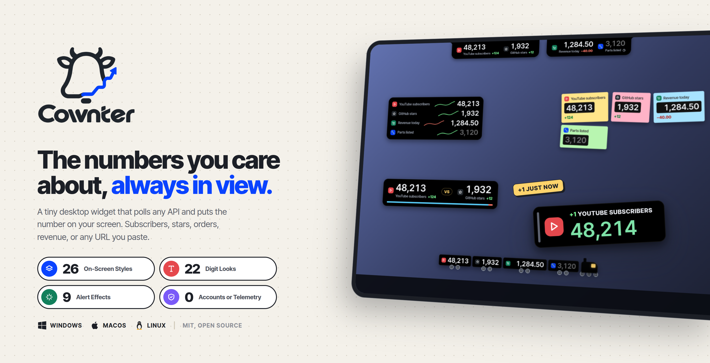
</p>

<p align="center">
  
</p>

<h3 align="center">The numbers you care about, always in view.</h3>

<p align="center">
  A tiny desktop widget that polls any API and puts the number on your screen.<br>
  Subscribers, stars, orders, revenue, or any URL you paste.
</p>

<p align="center">
  <a href="LICENSE"></a>
  <a href="../../releases"></a>
  
  
  
</p>

## Contents

- [Why Cownter](#why-cownter)
- [Screenshots](#screenshots)
- [On-screen styles](#on-screen-styles)
- [Customize a style](#customize-a-style)
- [Digit looks and colours](#digit-looks-and-colours)
- [Sources](#sources)
- [Goals, sounds and celebrations](#goals-sounds-and-celebrations)
- [Alerts and effects](#alerts-and-effects)
- [Formulas](#formulas)
- [Share and export](#share-and-export)
- [Push and command line](#push-and-command-line)
- [Sync between computers](#sync-between-computers)
- [Shortcuts and the tray](#shortcuts-and-the-tray)
- [Install](#install)
- [Updates](#updates)
- [Build from source](#build-from-source)
- [How it works](#how-it-works)
- [Privacy](#privacy)
- [Contributing](#contributing)

## Why Cownter

You keep a browser tab open just to watch one number. Cownter puts that number on your desktop in a widget the size of a notification. It refreshes on its own schedule, keeps a history, and tells you when something moves.

- **Any source.** YouTube, GitHub, Shopify, Stripe, Plausible, npm, Gumroad, Lemon Squeezy, Product Hunt, Discord, or any URL that returns JSON, HTML or plain text. Click the value you want in a live preview of the response.
- **Push instead of poll.** Send a number from a script, a webhook or the `cownter` command line and it updates at once.
- **Numbers or text.** Track a count, or a text such as an order status, a build state or a version number.
- **26 on-screen styles.** From a calm pill at the top of the screen to a train that drives along your taskbar.
- **22 digit looks.** 19 font families plus dot-matrix, calculator and neon, in eight colours including an RGB chroma wave.
- **Alerts with effects.** Float a +1 over the widget, throw confetti, shake it, flash it, or send a desktop notification.
- **Goals and records.** A progress bar to your goal, a forecast of the day you'll reach it, streaks of days going up, and confetti when you get there.
- **Weekly recap.** Every Monday, a card with each number's week and its best day.
- **Share and export.** Turn a number into a PNG card, or export its history as CSV.
- **History.** Sparklines and today's change for every number. A year of data is kept, then compacted.
- **Private by design.** No account, no server, no telemetry. Keys and tokens live in your system keyring.
- **Updates itself.** New releases install from GitHub with one click.

## Screenshots

| Your numbers | Pick a style |
| --- | --- |
| 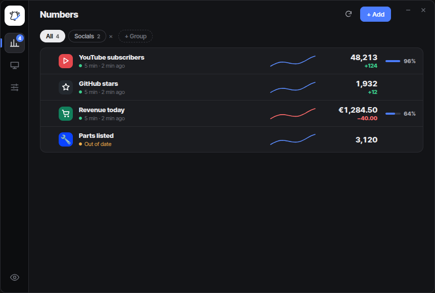 | 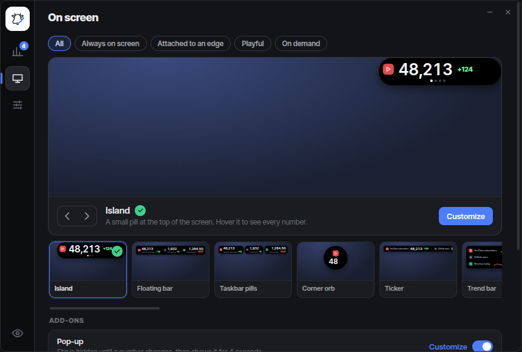 |
| **Customize every detail** | **Design alerts and effects** |
| 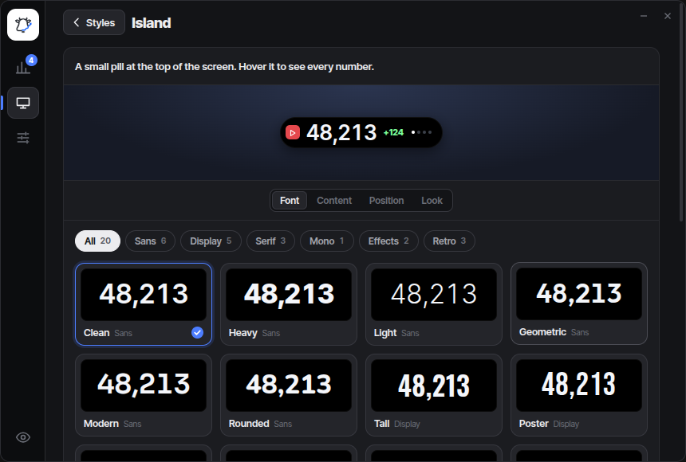 | 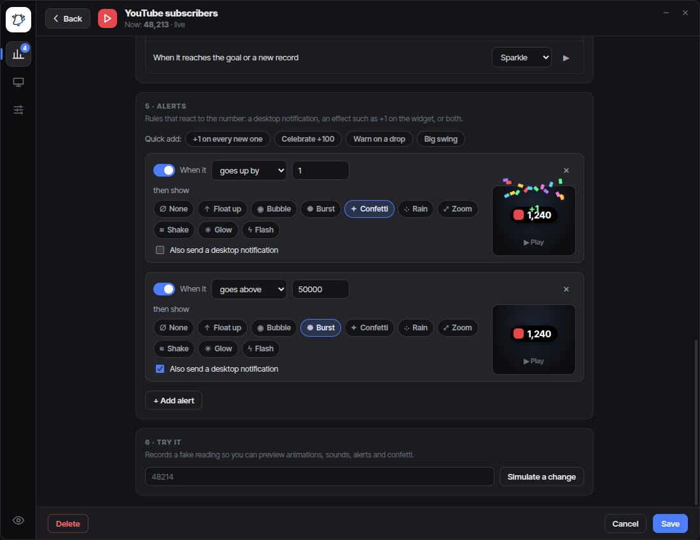 |

### Style gallery

**Always on screen**

| Island | Floating bar | Taskbar pills |
| --- | --- | --- |
| 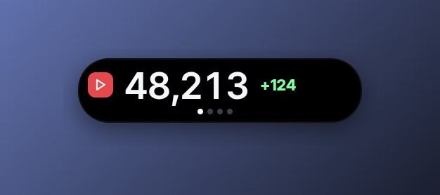 | 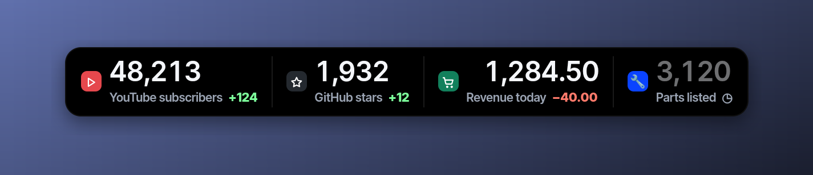 | 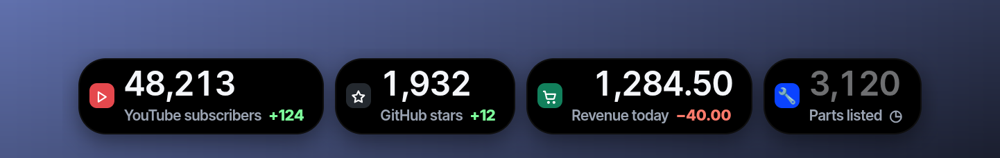 |
| **Corner orb** | **Ticker** | **Trend bar** |
| 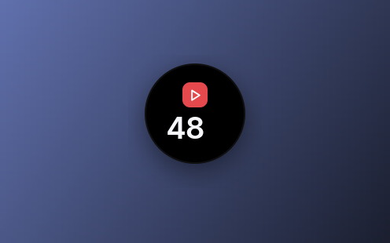 | 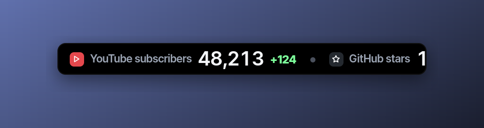 | 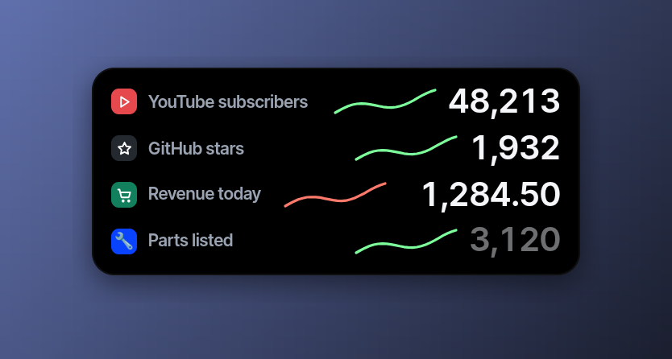 |
| **Sticky chips** | **Versus** | **Stream overlay** |
| 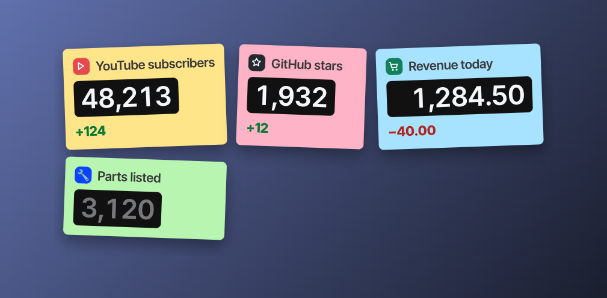 | 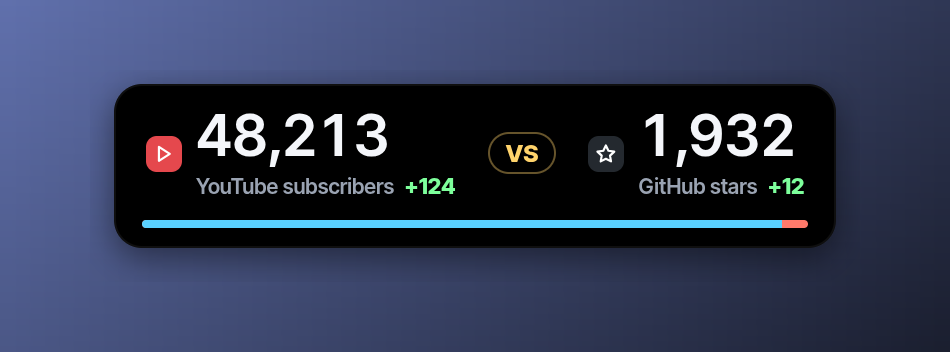 | 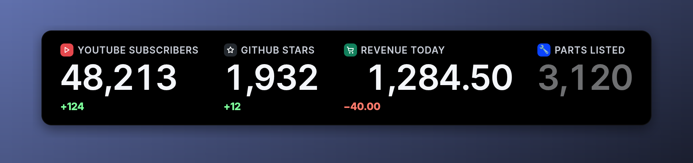 |

**Attached to an edge**

| Edge tab | Pull-out drawer | Welded notch |
| --- | --- | --- |
| 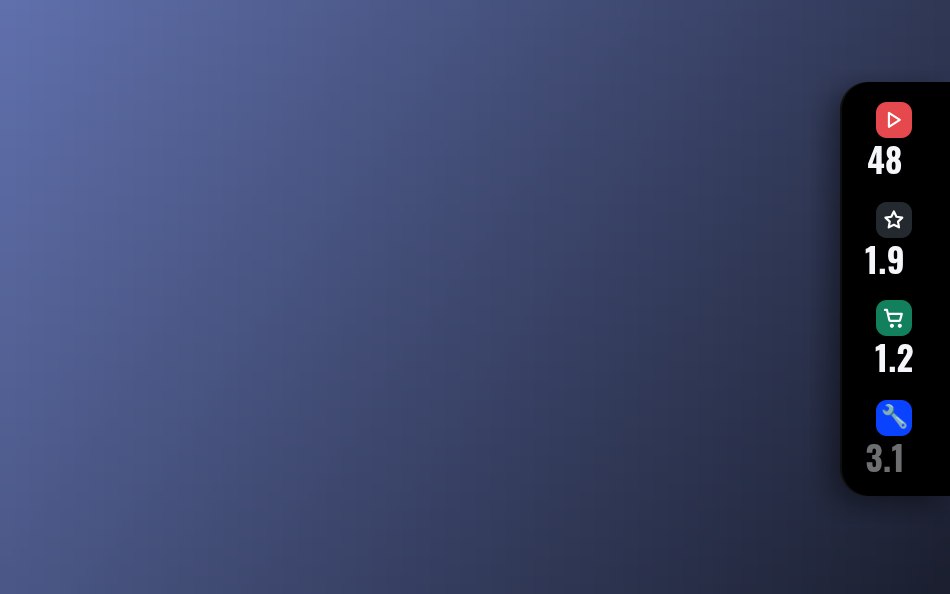 | 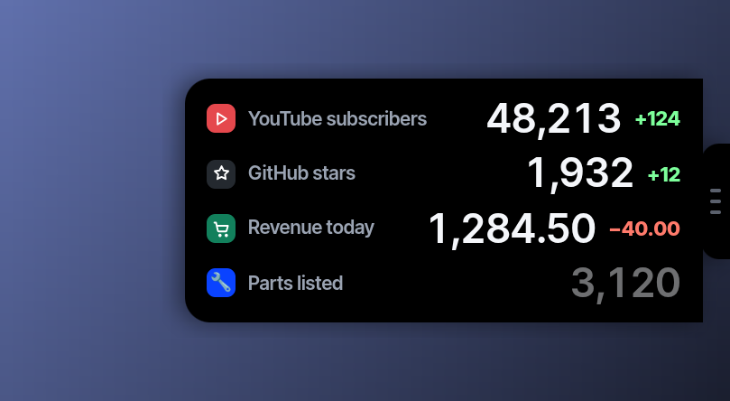 | 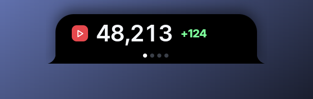 |
| **Notch wings** | **Top tabs** | **Folder tabs** |
| 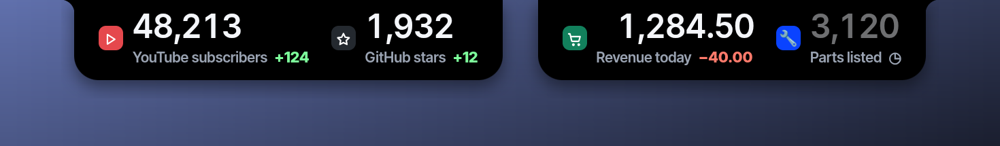 | 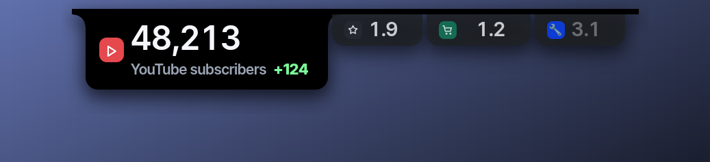 | 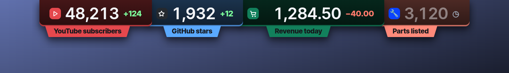 |
| **Taskbar deck** |   |   |
| 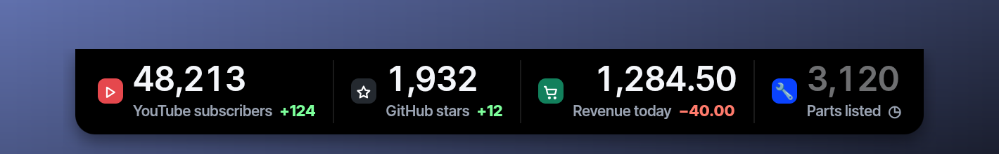 |   |   |

**Playful**

| Hanging tag | Clothesline | Train |
| --- | --- | --- |
| 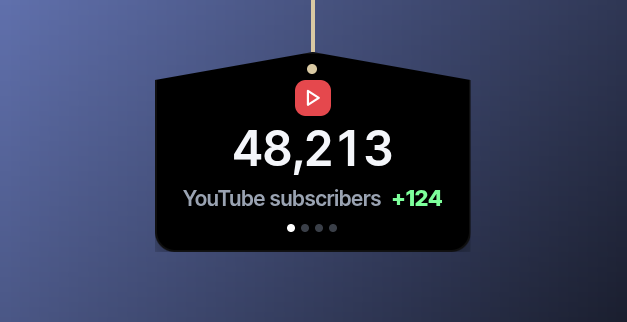 | 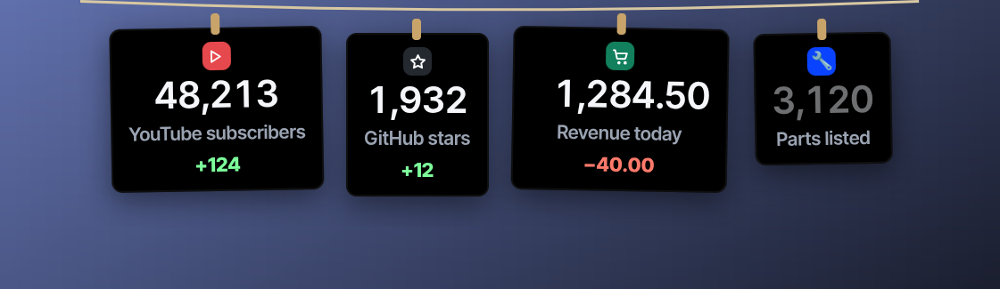 | 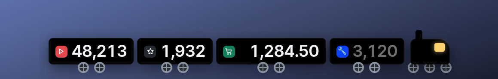 |
| **Desktop pet** | **Pager** |   |
| 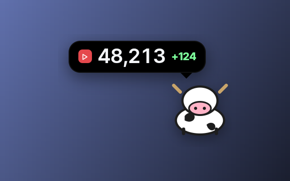 | 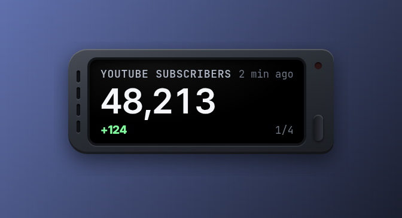 |   |

**On demand**

| Pop-up on change | Change feed | Quick peek |
| --- | --- | --- |
| 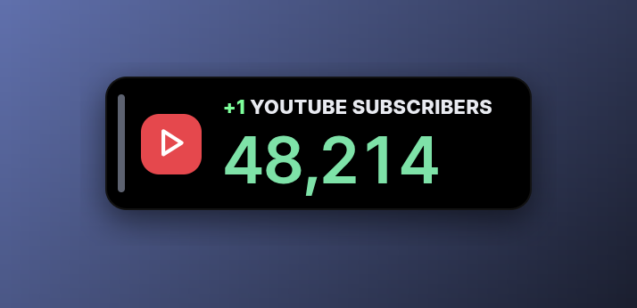 | 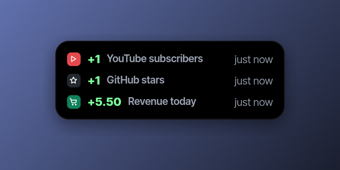 | 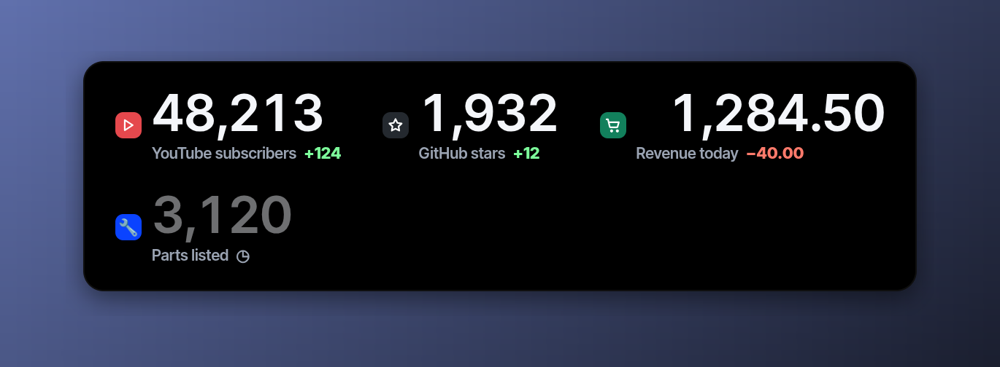 |

## On-screen styles

Open **Styles**, click a style to turn it on, then click **Customize** to tune it. You can run several styles at once, each with its own numbers and settings.

### Always on screen

| Style | What it is |
| --- | --- |
| Island | A small pill at the top of the screen. Hover it to see every number. |
| Floating bar | One slim bar with all your numbers side by side. |
| Taskbar pills | Separate little pills lined up along the bottom. |
| Corner orb | A round bubble in a corner. Hover it to open the list. |
| Ticker | A news-style band that scrolls through your numbers. |
| Trend bar | Numbers with a small chart of the last day. |
| Sticky chips | Colourful sticky notes, one per number. |
| Versus | Two numbers face off on a scoreboard, with an optional VS badge and comparison bar. |
| Stream overlay | Big, bold numbers made for OBS and live streams. |

### Attached to an edge

| Style | What it is |
| --- | --- |
| Edge tab | A slim tab on the side of the screen. Hover it to slide out the details. |
| Pull-out drawer | A handle on the screen edge. Click it to pull out a drawer. |
| Welded notch | Grows out of the top edge like a camera notch. |
| Notch wings | Two wings on either side of the top centre, with an adjustable middle gap. |
| Top tabs | Browser-style tabs hanging from the top edge. |
| Folder tabs | Folder-style tabs, each in its own colour. |
| Taskbar deck | A strip that sits right on top of the taskbar. |

### Playful

| Style | What it is |
| --- | --- |
| Hanging tag | A price tag on a string that swings when the number moves. |
| Clothesline | Cards pegged to a line across the top. |
| Train | A little train, one wagon per number, that drives across the screen along the taskbar. |
| Desktop pet | A cow that tells you the news in a speech bubble. |
| Pager | A retro pager that beeps through your numbers. |

### On demand

| Style | What it is |
| --- | --- |
| Pop-up | Stays hidden until a number changes, then shows the change for 4 seconds. |
| Change feed | A running list of the latest changes. |
| Quick peek | Press `Ctrl/Cmd + Shift + P` to see every number in the middle of the screen for a few seconds. |
| Tray number | One number next to the Cownter icon in the menu bar or system tray. |
| Goal confetti | Confetti when a goal is reached or a number sets a new record. |

## Customize a style

Every style has four tabs, and every setting is saved per style.

| Tab | Settings |
| --- | --- |
| **Font** | The digit look, its colour, and the look's own switches. |
| **Content** | Which numbers it shows (all, a group or a hand-picked list), icons and icon style, names, today's change, page dots, what click and hover do, how fast it cycles, and switches for each indicator of that style (status marks, the change animation, separators, smoke, the pager's light and more). |
| **Position** | Screen, anchor (9 spots), side and height for edge styles, and pixel offsets with fine nudge buttons. Widgets can move right up to the edge of the screen. |
| **Look** | Size, fine scale, background colour and opacity, corner roundness, spacing between tiles, widget opacity and shadow. |

**Icon styles:** tile, big tile, glowing badge, sticker, bare glyph, colour bar, colour fade, split colour block, full-height cover, slanted cover, big faint ghost, tilted watermark, blurred colour wash, a stomping kinetic icon, or shuffle through them all. Each style is shown as a live preview in the picker. Icons can be one of 52 built-in symbols, any emoji, an uploaded image, or a website's own icon, on a background colour of your choice.

## Digit looks and colours

<p align="center">
  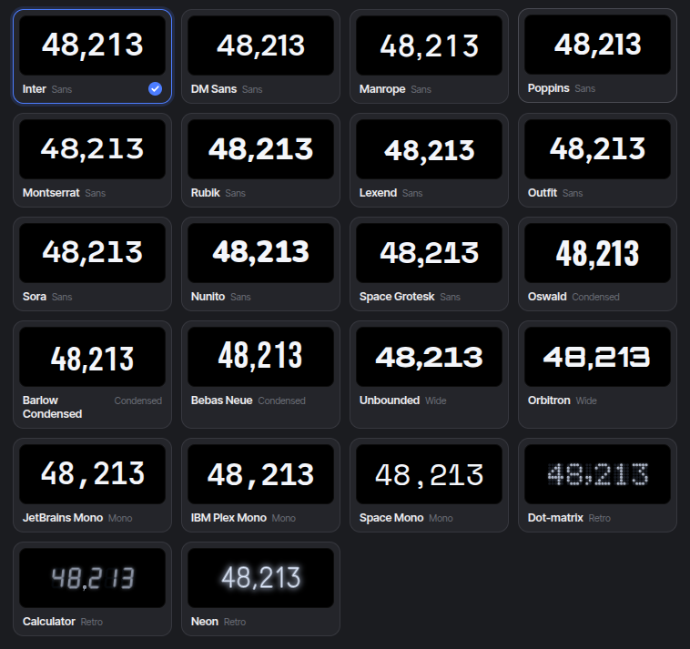
</p>

| Group | Looks |
| --- | --- |
| Sans | Inter, DM Sans, Manrope, Poppins, Montserrat, Rubik, Lexend, Outfit, Sora, Nunito, Space Grotesk |
| Condensed | Oswald, Barlow Condensed, Bebas Neue |
| Wide | Unbounded, Orbitron |
| Mono | JetBrains Mono, IBM Plex Mono, Space Mono |
| Retro | Dot-matrix, Calculator LCD, Neon tubes |

- **Font switches:** bold, thin, italic, outline only, gradient, soft glow, drop shadow, small symbols.
- **Retro switches:** dark panel, unlit dots or segments, square dots, glow, bright neon core, flicker.
- **Colours:** white, RGB chroma (a rainbow wave that runs across the digits), amber, phosphor green, ice, ruby, violet and classic LCD.

All fonts are bundled with the app, so they look the same on every system and need no internet connection.

## Sources

| Source | What you get | Needs |
| --- | --- | --- |
| Any URL | A number or a text, picked from JSON by clicking it, or the first number, or a regex | Optional headers. Secret headers go to the keyring. |
| YouTube | Subscribers, views, videos | A free YouTube Data API key |
| GitHub | Stars, forks, watchers, open issues, followers, public repos | Nothing (a token raises the rate limit) |
| Shopify | Orders today | An Admin API access token |
| Stripe | Revenue today, refunds subtracted | A restricted key with read access to charges |
| Plausible | Visitors today, visitors right now | A Plausible API key |
| npm | Downloads in the last 7 days | Nothing |
| Gumroad | Sales, revenue | An access token |
| Lemon Squeezy | Sales, revenue, revenue in the last 30 days | An API key |
| Product Hunt | Upvotes on a post | A developer token |
| Discord | Members, members online | An invite code, nothing else |
| Push | Whatever you send it | Nothing (see [Push and command line](#push-and-command-line)) |
| Formula | Math on your other numbers | Nothing |

- Each number has its own refresh interval, from 10 seconds up.
- Numbers can be shown in full (`48,213`) or compact (`48.2K`), with decimals, a prefix and a suffix (`€`, `%`, ` stars`).
- Failed requests back off politely, `Retry-After` is honoured, and a rejected key pauses that number until you fix it.
- **Text values.** With Any URL, switch **Shows** to **Text** to track words instead of a count, for example a parcel status. The goal can be a text, such as "becomes Delivered".
- **Groups.** Put numbers in groups (Socials, Shop, Work) and give each style a group to show.

## Goals, sounds and celebrations

- Set a goal for any number. Styles show a progress bar, and Cownter celebrates with confetti when you reach it or set a new all-time high.
- **Forecast.** From the last 30 days of history, Cownter estimates the day you'll reach the goal: `153 to go · ~Nov 12`.
- **Streaks.** `🔥 5` means the number ended higher than the day before, five days in a row.
- **Weekly recap.** On the day you choose (Monday by default), a card shows each number's change over the week and its best day. Turn it off or show it now under **General → Weekly recap**, or from the tray.
- Seven soft built-in sounds: chime, bubble, soft tick, pop, marimba, glass bell and sparkle. Pick one for "on every change" and one for "on goal or record", with a master volume and a mute switch.
- **Sound packs.** Swap the whole set for Cash register, Crowd cheer, Arcade or Cowbell, for everything or for one number.
- **Pet.** The pet style grows from an egg to a crowned cow as the number climbs toward its goal.
- **Seasonal touches.** Optional Halloween, Christmas and New Year colours, under **On screen → Seasons**.
- **Try it** in the number editor records a fake reading, so you can preview animations, sounds, alerts and confetti before they happen for real.

## Alerts and effects

<p align="center">
  
</p>

Alerts are written as a sentence: **When it** *goes up by 1* **then show** *Confetti* **and** *send a notification*.

| Rule | Fires when |
| --- | --- |
| goes up by N | a refresh brings a rise of N or more |
| goes down by N | a refresh brings a drop of N or more |
| goes above N | the number crosses above N |
| goes below N | the number crosses below N |
| changes by N % | the number moves by N % within 15 minutes, an hour, 6 hours, a day or a week |
| rises by N % | the number climbs N % above its lowest point in the window |
| drops by N % | the number falls N % below its highest point in the window |

**Effects on the widget:** float up, bubble, burst, confetti, rain, zoom, shake, glow and flash. Each one shows the real change, such as `+1` or `-3`, in green or red. A live preview plays the effect as you pick it.

**Quick add:** one click for "+1 on every new one", "Celebrate +100", "Warn on a drop", "Big swing" or "Sudden 5% drop".

**Checks:** the designer warns you when an alert does nothing, duplicates another one, or is already past its line.

## Formulas

Combine numbers with `+ - * /` and brackets, using the short name of each number:

```
orders_today / visitors_today * 100
youtube_subscribers + github_followers
```

Formulas recalculate on their own refresh timer (10 seconds or longer). Cownter rejects loops (a formula that uses itself) and won't let you rename a number that a formula still uses.

## Share and export

- **Snapshot.** Hover a number in the Numbers list and click the share icon for a PNG card with the value, today's change, a sparkline, the streak and the goal. Copy it or save it to `~/Pictures`.
- **CSV.** Export one number or all of them from the Numbers page. Files go to `~/Downloads` and are never overwritten.

## Push and command line

Pick **Push** as the source and the number waits for you to send it values. Cownter listens on `127.0.0.1:47615` only, with a token you'll find under **General → Push and command line**.

```sh
cownter set "Orders" 42
cownter add "Orders" 1
cownter get "Orders"
cownter list
cownter export "Orders" --out orders.csv
```

```sh
curl -X POST http://127.0.0.1:47615/v1/add \
  -H "Authorization: Bearer <token>" \
  -d '{"entry": "Orders", "by": 1}'
```

The full endpoint reference is in [docs/push-and-cli.md](docs/push-and-cli.md).

## Sync between computers

Under **General → Sync settings**, point each computer at the same synced folder (Syncthing, Dropbox, iCloud Drive). Numbers, groups, alerts and the on-screen setup are shared through one `cownter-settings.json` file. Keys and tokens stay in each computer's keyring and are never written to it.

## Shortcuts and the tray

| Action | Default |
| --- | --- |
| Show or hide all widgets | `Ctrl/Cmd + Shift + U` |
| Refresh all numbers | `Ctrl/Cmd + Shift + R` |
| Quick peek | `Ctrl/Cmd + Shift + P` |

Change them under **General → Shortcuts**. The tray menu opens Cownter, refreshes everything, hides the widgets, or quits. The tray can show one number next to its icon: as text on macOS and Linux, drawn into the icon on Windows. Cownter can also start when you log in.

## Install

Download the installer for your system from the [Releases](../../releases) page.

| System | File |
| --- | --- |
| Windows 10 and 11 | `.msi` or `-setup.exe` |
| macOS, Apple Silicon | `aarch64.dmg` |
| macOS, Intel | `x64.dmg` |
| Linux | `.AppImage`, `.deb` or `.rpm` |

The installers are not code-signed yet:

- **Windows:** SmartScreen may warn you. Click **More info**, then **Run anyway**.
- **macOS:** right-click the app, choose **Open**, then confirm.
- **Linux:** make the AppImage executable with `chmod +x Cownter_*.AppImage`. On Wayland, Cownter runs through XWayland so widgets can be placed precisely.

## Updates

From version 0.2.2, Cownter checks GitHub for a new release when it starts and every 6 hours, and tells you when one is ready. Install it under **General → Updates**; Cownter restarts on the new version. On Linux, the `.deb` and `.rpm` updates ask for your password. Updates are signed, and the check can be turned off.

## Build from source

Requirements: [Rust](https://rustup.rs) (stable), [Node.js](https://nodejs.org) 20+, [pnpm](https://pnpm.io), and the [Tauri prerequisites](https://v2.tauri.app/start/prerequisites/) for your system.

On Debian or Ubuntu:

```bash
sudo apt install libwebkit2gtk-4.1-dev libgtk-3-dev libayatana-appindicator3-dev librsvg2-dev libssl-dev libsecret-1-dev build-essential
```

Then:

```bash
git clone https://github.com/911RS/cownter.git
cd cownter
pnpm install
pnpm tauri dev      # run in development
pnpm tauri build    # build installers into target/release/bundle
```

Tests:

```bash
cargo test --workspace   # engine, sources, scheduler, rules, app config
pnpm test                # formatting, digit looks, selection, text values
pnpm typecheck
```

Releases: push a tag such as `v0.1.1` and the **Release** workflow builds the installers for Windows, macOS (both chips) and Linux, then attaches them to a GitHub release.

## How it works

```
crates/cownter-core   Rust engine: sources, parsing, formulas, SQLite history, rules, keyring, scheduler
src-tauri             Desktop shell: windows, tray, shortcuts, notifications, commands
src                   React UI: settings window, on-screen styles, digit looks, effects
```

- The engine polls each source on its own timer, with at most six requests in flight.
- Readings go into a local SQLite database.
- Rules turn new readings into events: changes, alerts, goals and all-time highs.
- The shell forwards those events to small transparent, always-on-top windows.
- Each window is sized to its content, so the rest of your screen stays clickable. Styles that expand on hover keep their open size and only the visible panel takes clicks, so they grow smoothly without resizing the window.

## Privacy

- Cownter only contacts the addresses you add, plus GitHub to check for updates (you can turn that off).
- The push endpoint listens on `127.0.0.1` only and needs a token.
- History is stored in a local database in your app data folder.
- API keys and tokens are stored only in your system's keyring (Keychain, Credential Manager or Secret Service), never in Cownter's own files.
- No account, no analytics, no crash reporting.

## Contributing

Issues and pull requests are welcome. Please run the tests before you open a pull request, and keep new styles consistent with the existing ones: every style supports the Font, Content, Position and Look tabs.

## License

[MIT](LICENSE)
