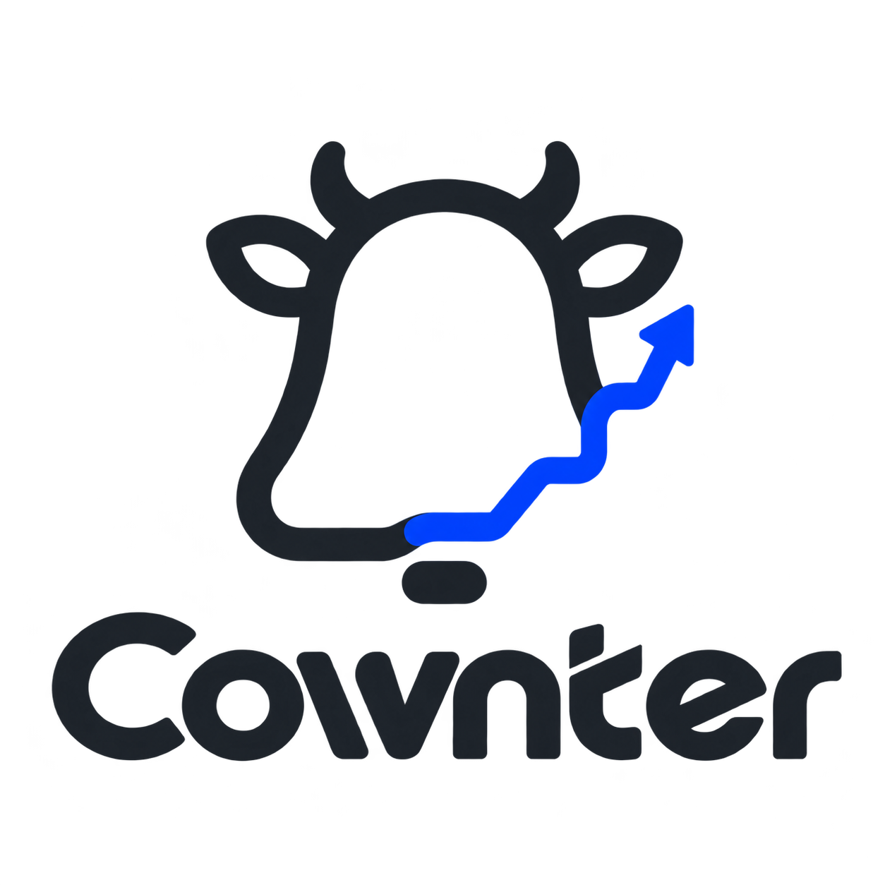
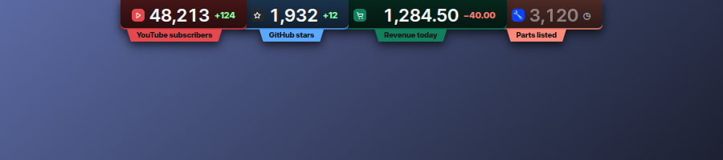

<p align="center">
  
</p>

<p align="center">
  <b>The numbers you care about, always in view.</b><br>
  A tiny desktop widget that polls any API and shows the number. Subscribers, orders, revenue, stars, or any URL you paste.
</p>

<p align="center">
  <a href="LICENSE"></a>
  
  
  
</p>

<p align="center">
  
</p>

## Why Cownter

You keep a browser tab open just to watch one number. Cownter puts that number on your desktop in a widget the size of a notification. It refreshes on its own schedule, remembers history and tells you when something moves.

- **Any source.** YouTube, GitHub, Shopify, Stripe, or any URL that returns JSON, HTML or plain text. Click the value you want in a live preview of the response.
- **Numbers or text.** Track a count, or a text such as an order status or a version, with a goal like "becomes Delivered".
- **26 on-screen styles.** Island, floating bar, notch, edge tab, ticker, sticky notes, folder tabs, a clothesline, a train that drives along your taskbar, a desktop cow and more. Pick one, then tune every detail.
- **19 font families plus 3 retro looks.** Inter, DM Sans, Manrope, Poppins, Montserrat, Rubik, Oswald, Bebas Neue, JetBrains Mono and more, with bold, thin, italic, outline and gradient switches. Dot-matrix, calculator and neon for a retro feel. Eight colours, including an RGB chroma wave.
- **History and trends.** Sparklines and today's change for each number. Data is kept for a year, then compacted.
- **Alerts and effects.** "When it goes up by 1, float +1 over the widget", "when it goes above 10,000, notify me", or both. Ten effects (float, bubble, burst, confetti, rain, zoom, shake, glow, flash) with a live preview and one-click templates. Goals celebrate with confetti.
- **Formulas.** Combine numbers, such as `orders / visitors * 100`.
- **Soft sounds.** Seven built-in sounds you can play when a number changes or a goal is reached.
- **Private by design.** No account, no server, no telemetry. Keys and tokens live in your system keyring.

## Screenshots

| Numbers | Pick a style |
| --- | --- |
|  |  |
| **Customize everything** | **Alerts and effects** |
|  |  |

<p align="center">
  
</p>

| Notch | Clothesline | Desktop pet |
| --- | --- | --- |
|  |  |  |
| **Sticky chips** | **Train** | **Folder tabs** |
|  |  |  |
| **Pager** | **Top tabs** | **Island** |
|  |  |  |

## Styles

| Group | Styles |
| --- | --- |
| Always on screen | Island, Floating bar, Taskbar pills, Corner orb, Ticker, Trend bar, Sticky chips, Versus, Stream overlay |
| Attached to an edge | Edge tab, Pull-out drawer, Welded notch, Notch wings, Top tabs, Folder tabs, Taskbar deck |
| Playful | Hanging tag, Clothesline, Train, Desktop pet, Pager |
| Add-ons | Pop-up on change, Change feed, Quick peek shortcut, Tray number, Goal confetti |

Every style can be customized:

- **Font:** 22 looks in five groups, eight colours, and options per look (bold, thin, italic, outline, gradient, glow, unlit dots, LCD panel, flicker and more).
- **Content:** which numbers it shows, icons and icon style (tile, colour fade, glow, glyph, side bar), names, today's change, page dots, click and hover behaviour, cycle speed, and switches for every indicator (status marks, separators, the VS badge, smoke, the pager's light and more).
- **Position:** screen, anchor (9 spots), side and height for edge styles, pixel offsets with fine nudge buttons. Widgets can move right up to the screen edge.
- **Look:** size, fine scale, background colour and opacity, corner roundness, spacing between tiles, the middle gap of the notch wings, widget opacity, shadow.

## Sources

| Source | What you get | Needs |
| --- | --- | --- |
| Any URL | A number or a text picked from JSON (click it), the first number or line, or a regex | Optional headers, stored in the keyring if secret |
| YouTube | Subscribers, views, videos | A free YouTube Data API key |
| GitHub | Stars, forks, watchers, open issues, followers, public repos | Nothing (a token raises the rate limit) |
| Shopify | Orders today | An Admin API access token |
| Stripe | Revenue today, refunds subtracted | A restricted key with read access to charges |
| Formula | Math on your other numbers | Nothing |

Each number has its own refresh interval. Failed requests back off politely, `Retry-After` is honoured, and a rejected key pauses that number until you fix it.

## Install

Download the installer for your system from the [Releases](../../releases) page:

| System | File |
| --- | --- |
| Windows | `.msi` or `-setup.exe` |
| macOS (Apple Silicon or Intel) | `.dmg` |
| Linux | `.AppImage`, `.deb` or `.rpm` |

Builds are made by GitHub Actions for every version tag. The installers are not code-signed yet, so Windows SmartScreen and macOS Gatekeeper may ask you to confirm the first launch (on macOS: right-click the app, then Open).

### Build from source

Requirements: [Rust](https://rustup.rs) (stable), [Node.js](https://nodejs.org) 20+, [pnpm](https://pnpm.io), and the [Tauri prerequisites](https://v2.tauri.app/start/prerequisites/) for your OS.

On Debian or Ubuntu:

```bash
sudo apt install libwebkit2gtk-4.1-dev libgtk-3-dev libayatana-appindicator3-dev librsvg2-dev libssl-dev libsecret-1-dev build-essential
```

Then:

```bash
git clone https://github.com/911RS/cownter.git
cd cownter
pnpm install
pnpm tauri dev      # run in development
pnpm tauri build    # build installers into target/release/bundle
```

### Tests

```bash
cargo test --workspace   # engine, sources, scheduler, app config
pnpm test                # formatting, skins, selection, text values
pnpm typecheck
```

### Releases

Push a tag such as `v0.1.0` and the `Release` workflow builds installers for Windows, macOS and Linux and attaches them to a GitHub release.

## Shortcuts

| Action | Default |
| --- | --- |
| Show or hide widgets | `Ctrl/Cmd + Shift + U` |
| Refresh all numbers | `Ctrl/Cmd + Shift + R` |
| Quick peek: every number in the middle of the screen for 4 seconds | `Ctrl/Cmd + Shift + P` |

You can change them under **General → Shortcuts**.

## How it works

```
crates/cownter-core   Rust engine: sources, parsing, formulas, SQLite history, rules, keyring, scheduler
src-tauri             Desktop shell: windows, tray, shortcuts, notifications, commands
src                   React UI: settings window, widget forms, digit skins
```

The engine polls each source on its own timer, with at most six requests in flight. Readings go into a local SQLite database. Rules turn new readings into events: changes, alerts, goals and all-time highs. The shell forwards those events to small transparent, always-on-top windows. Each window is sized tightly to its content, so the rest of your screen stays clickable.

On Linux under Wayland, Cownter runs through XWayland so widgets can be placed precisely.

## Privacy

Cownter only contacts the addresses you add. History is stored in a local database in your app data folder. API keys and tokens are stored only in your operating system's keyring (Keychain, Credential Manager or Secret Service), never in Cownter's files.

## Contributing

Issues and pull requests are welcome. Please run the tests before opening a pull request.

## License

[MIT](LICENSE)
